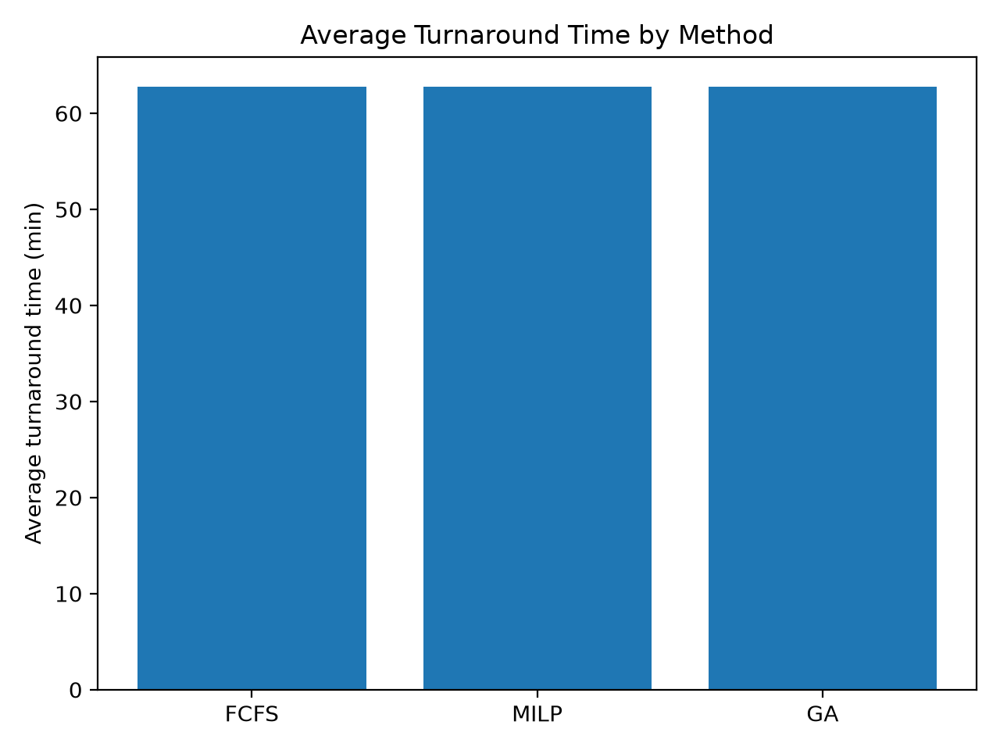
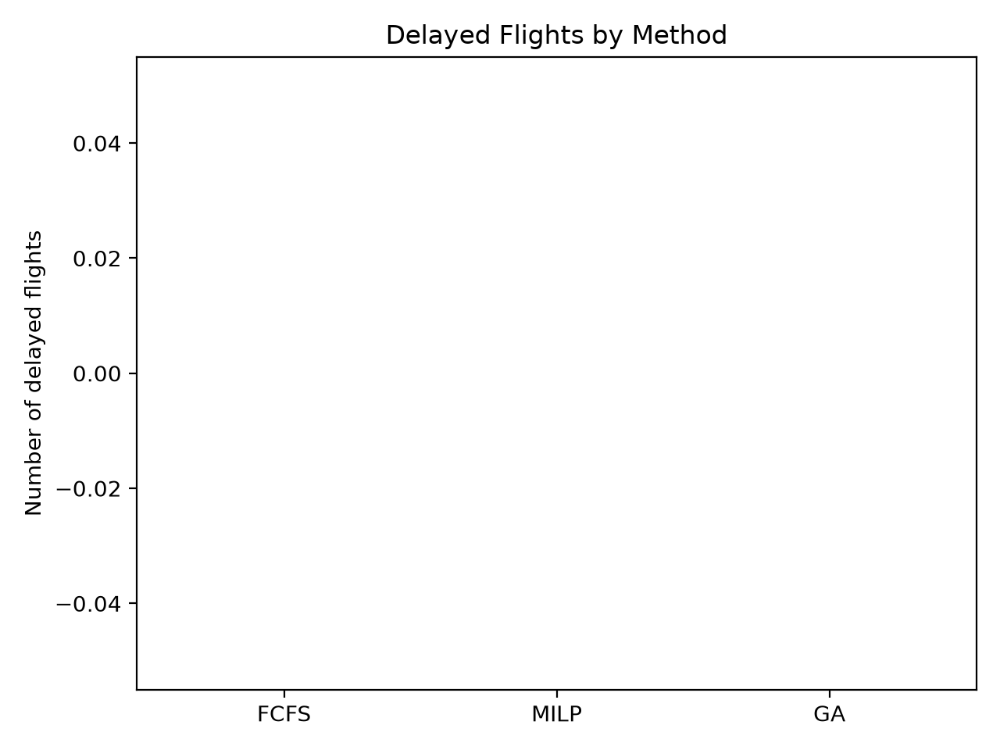
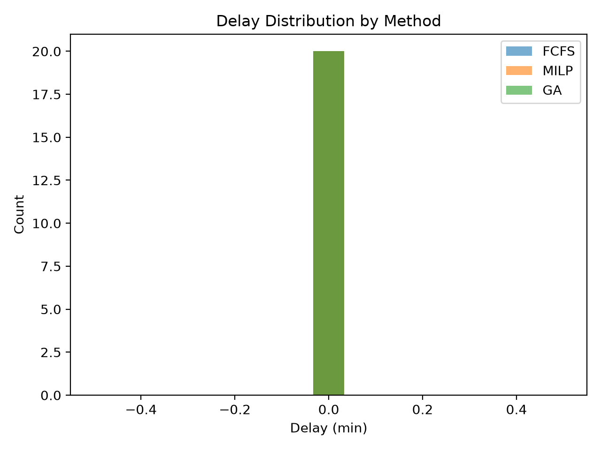

# Airport Ground Operations Optimization

A Python optimization project exploring how different scheduling strategies can allocate limited airport resources while minimizing flight delays and turnaround time.

The project compares three approaches:

- **First-Come, First-Served (FCFS)** — simple scheduling baseline
- **Mixed-Integer Linear Programming (MILP)** — exact optimization using PuLP and CBC
- **Genetic Algorithm (GA)** — heuristic optimization for larger search spaces

The goal is not only to compare solution quality, but also to explore the trade-off between **exact optimization and computational scalability**.

---

## Problem

Airport turnaround operations require several activities to be completed before an aircraft can depart.

In this simplified model, each flight requires:

- cleaning
- refueling
- boarding
- one available gate
- one available ground crew

Flights have different arrival times, service durations and scheduled departure times.

The scheduling problem consists of assigning each flight to a **gate** and a **crew**, while determining its start time and preventing resource conflicts.

The main objective is to minimize departure delays.

---

## Optimization Approaches

### 1. FCFS Baseline

Flights are processed in arrival order and assigned to the earliest available gate and crew.

This provides a simple and fast reference solution against which optimization methods can be compared.

### 2. Mixed-Integer Linear Programming

The MILP model uses binary assignment and ordering variables to represent:

- gate allocation
- crew allocation
- resource non-overlap constraints
- flight start and completion times
- departure delays

The optimization is performed lexicographically:

1. minimize total departure delay;
2. among solutions with minimum delay, minimize total completion time.

The model is solved using the **CBC solver through PuLP**.

### 3. Genetic Algorithm

The genetic algorithm represents a candidate solution as a permutation of flights.

Each permutation is decoded into a feasible schedule and evaluated using a fitness function combining completion time and departure delay.

The algorithm includes:

- tournament selection
- ordered crossover
- swap mutation
- elitism

This provides a heuristic alternative to the exact MILP formulation.

---

## Results

The default experiment uses:

- **20 flights**
- **5 gates**
- **5 ground crews**
- fixed random seed (`42`) for reproducibility

| Method | Avg. Turnaround | Delayed Flights | Total Delay |
|---|---:|---:|---:|
| FCFS | 62.75 min | 0 | 0 min |
| MILP | 62.75 min | 0 | 0 min |
| Genetic Algorithm | 62.75 min | 0 | 0 min |

For this small instance, all three approaches find schedules without departure delays, while the MILP solver reaches an optimal solution.

The experiment also highlighted an important limitation of exact optimization. With **50 flights**, the MILP formulation becomes significantly larger and CBC reaches the 30-second time limit before proving optimality. This illustrates the scalability challenge of exact combinatorial optimization and motivates the use of heuristic approaches such as genetic algorithms for larger instances.

---

## Visualizations

### Average Turnaround Time



### Delayed Flights



### Delay Distribution



The experiment outputs are also saved in [`results/summary.csv`](results/summary.csv).

---

## Project Structure

```text
airport-optimization/
│
├── airport_optimization.py
├── requirements.txt
├── README.md
├── .gitignore
├── .gitattributes
│
├── figures/
│   ├── avg_turnaround.png
│   ├── delayed_flights.png
│   └── delay_hist.png
│
└── results/
    └── summary.csv
```

---

## Running the Project

Clone the repository and install the dependencies:

```bash
pip install -r requirements.txt
```

Then run:

```bash
python airport_optimization.py
```

The script generates the scheduling results, saves the summary metrics to `results/summary.csv`, and exports the figures to the `figures/` directory.

---

## Tech Stack

- Python
- PuLP
- CBC MILP Solver
- Matplotlib
- Genetic Algorithms
- Operations Research

---

## What I Learned

This project gave me practical experience translating a scheduling problem into mathematical constraints and comparing exact and heuristic optimization techniques.

In particular, it helped me understand:

- how resource allocation problems can be formulated as MILPs;
- how Big-M and non-overlap constraints are used in scheduling;
- how lexicographic objectives can prioritize operational goals;
- how genetic algorithms can provide alternative solutions without solving the full mathematical optimization problem;
- why exact optimization can become computationally expensive as problem size increases.

The project also reinforced the importance of validating solver status and interpreting time-limited optimization results rather than relying only on the status exposed by a high-level library.

---

## Limitations and Future Work

The current project uses synthetic flight data and a simplified representation of airport ground operations.

Possible extensions include using real operational data, modeling different aircraft and gate compatibility constraints, introducing multiple ground-service teams, and benchmarking MILP and heuristic performance across increasing instance sizes.

The current version intentionally focuses on the core scheduling and optimization problem.